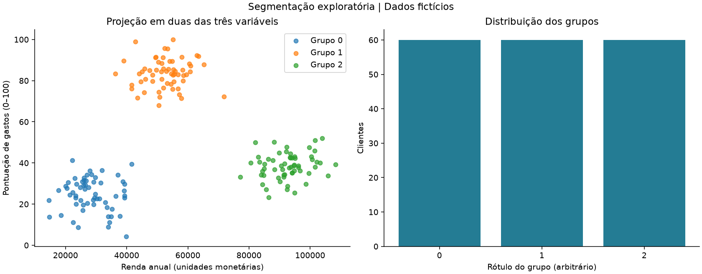

# Análises de Marketing — segmentação exploratória

Python, análise de dados e KMeans para explorar perfis de clientes. A versão pública usa dados inteiramente fictícios, compara alternativas de agrupamento e publica resultados reproduzíveis com controles de qualidade.

## Contexto e evolução

O estudo original aplicou Pandas, StandardScaler e KMeans a idade, salário anual e pontuação de gastos. Seu objetivo era apoiar a segmentação e a formulação de estratégias de marketing e relacionamento. A evidência publicada era um PDF incompleto de notebook, sem dados ou código executável.

O README histórico também descrevia Power BI, DAX e quatro páginas de análise: perfil de clientes, comportamento de consumo, campanhas e fidelização. Esses itens permanecem como **contexto relatado do projeto original**: os respectivos dashboards, medidas e resultados comerciais não estão disponíveis para verificação neste repositório. Recorrência, conversão, retenção e redução de custos não são resultados comprovados pelas três variáveis do modelo.

A implementação atual recupera o fluxo analítico e acrescenta contratos de entrada, avaliação dos clusters, demonstração sintética, testes e automação de validação. O PDF antigo foi retirado da versão corrente por ser incompleto e conter registros sem origem documentada. Isso não apaga versões históricas. Os dados originais não foram restaurados ou utilizados.

## O que esta versão demonstra

- Validação de um cliente por linha, IDs textuais únicos, tipos e domínios.
- StandardScaler e KMeans com sementes e número de inicializações explícitos.
- Comparação de k entre 2 e 6, respeitando viabilidade e tamanho mínimo dos grupos.
- Silhouette, inércia, estabilidade entre sementes com ARI e comparação com RobustScaler.
- Perfis em unidades originais, contagens reconciliadas, CSVs, gráficos e manifesto com hashes.
- Publicação por geração: falhas antes da confirmação preservam a última saída válida.
- Notebook que usa a mesma implementação dos testes, sem duplicar o algoritmo.

Não é um modelo preditivo supervisionado. A pontuação artificial de gastos não mede frequência de compras, fidelização, gasto monetário ou conversão. Aplicações de marketing são hipóteses para validação posterior.



A demonstração de 180 clientes selecionou k=3, com 60 clientes por grupo e silhouette de aproximadamente 0,727. Os três componentes foram desenhados no gerador: o resultado comprova a execução da demonstração, não uma descoberta sobre clientes reais. [Métricas registradas](docs/evidence/comparacao_k.csv).

## Execução rápida — Python 3.12

Na raiz do repositório, crie e ative um ambiente virtual:

```bash
python -m venv .venv
```

Windows PowerShell: `.\.venv\Scripts\Activate.ps1`. Linux/macOS: `source .venv/bin/activate`.

```bash
python -m pip install -r requirements-lock.txt
python -m pip check
python scripts/run_analysis.py --demo
python scripts/run_tests.py
python scripts/validate_notebook.py
```

O lock contém dependências de execução e validação do notebook. `requirements.txt` declara o núcleo; `requirements-dev.txt` acrescenta as ferramentas de notebook. Não são necessários credenciais, PostgreSQL, Power BI ou serviços externos. A instalação pode precisar de internet; a análise sintética não consulta serviços externos.

Abra `outputs/demo/latest.json` para localizar a geração confirmada. Ela contém:

| Arquivo | Conteúdo |
| --- | --- |
| clientes_segmentados.csv | Uma linha por cliente fictício, três variáveis e cluster |
| perfis.csv | Contagens, médias, medianas e extremos por grupo |
| comparacao_k.csv | Métricas e elegibilidade dos candidatos |
| resumo.json | Decisões, limites, configuração, versões e hash da entrada |
| segmentos.png | Projeção de renda/pontuação e distribuição dos grupos |
| avaliacao.png | Inércia e silhouette por k |

Os rótulos dos grupos são arbitrários e não representam os grupos A/B/C descritos no README antigo.

## Exploração e dados próprios

O [notebook](notebooks/segmentacao.ipynb) apresenta o contrato, a comparação de k, os perfis e as limitações. O validador executa todas as células em um kernel temporário do Python ativo, sem instalar kernels globais.

O gerador cria 180 clientes fictícios com três componentes desenhados pelo autor. Isso favorece uma estrutura conhecida para testar o fluxo; não demonstra que uma população real possui três segmentos. Há também uma [amostra fictícia](examples/clientes_ficticios.csv), produzida pelo mesmo gerador com 30 linhas.

Somente para um CSV mínimo que você tenha autorização para utilizar:

```bash
python scripts/run_analysis.py --input data/clientes.csv --output outputs/local
python scripts/run_analysis.py --demo --k 3
```

O comando não transmite dados. Entradas devem seguir o [contrato](docs/CONTRATO_DADOS.md); campos extras são rejeitados. Dados próprios não são marcados como sintéticos, e a ferramenta não certifica anonimização, origem ou autorização. Entradas e saídas locais são ignoradas pelo Git.

## Arquitetura

```text
Gerador sintético / CSV autorizado
             ↓
Contrato e validação estrita
             ↓
StandardScaler → comparação de KMeans
             ↓
Perfis, estabilidade e sensibilidade
             ↓
Geração imutável com CSV + JSON + PNG
             ↓
latest.json confirma a publicação
```

`src/marketing/` concentra contratos, geração, modelo, gráficos e publicação. `scripts/` fornece os comandos; `tests/` verifica comportamento e falhas; `notebooks/` oferece a exploração; `.github/workflows/` define a validação automatizada. Nenhum banco foi adicionado porque não é necessário para este fluxo.

## Metodologia, testes e limites

Consulte a [metodologia](docs/METODOLOGIA.md), a [validação efetivamente realizada](docs/VALIDACAO.md), o [guia de reprodução](docs/REPRODUCAO.md) e os [cuidados com dados](SECURITY.md).

O workflow executa instalação fixada, verificação de dependências, testes, demonstração e notebook em Python 3.12. Sua presença não equivale a uma execução aprovada no GitHub: o estado observado é registrado no documento de validação.

Os testes cobrem dados inválidos, reprodutibilidade, reconciliação, casos degenerados, saída anterior preservada sob falha e execução fora da pasta do projeto. Métricas sintéticas e estabilidade entre sementes são evidências técnicas limitadas; não comprovam generalização temporal ou impacto de campanhas.

Os CSVs podem ser importados no Power BI conforme o [guia de BI](docs/POWER_BI.md). A versão pública entrega gráficos estáticos; não publica PBIX nem afirma execução de Power BI Desktop ou validação de DAX.
