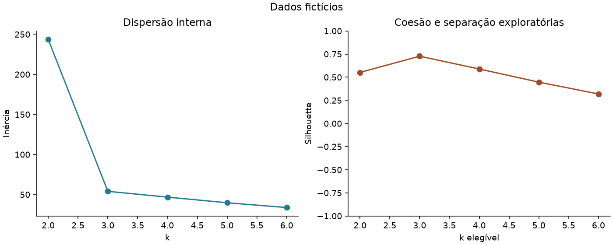

# Validação e registro das alterações

Data: 20/10/2026. Base: main em d26aafef4e62483fd7fc7291e606ac75ce1e3acb.
Estado: proposta na branch fix/profissionalizacao-marketing para revisão; integração na main ainda não realizada. Evidências abaixo registram a validação local anterior à publicação.

## Alterações por arquivo

| Arquivos | Entrega |
| --- | --- |
| src/marketing/contracts.py | Contrato mínimo, IDs textuais e rejeição de entradas inválidas sem coerção silenciosa |
| src/marketing/synthetic.py e examples/ | Dados inteiramente fictícios e origem documentada |
| src/marketing/model.py | Comparação de k, silhouette, inércia, estabilidade ARI e diagnóstico de sensibilidade |
| src/marketing/pipeline.py | Gerações imutáveis, hashes e confirmação por ponteiro; falhas preservam publicação anterior |
| src/marketing/plots.py | Gráficos estáticos exportáveis e identificados como fictícios na demonstração |
| notebooks/segmentacao.ipynb | Seis células executáveis usando os mesmos módulos testados, sem saída versionada |
| scripts/ | CLI, executor de testes e execução integral do notebook com encerramento do kernel |
| tests/ | Contratos, modelo, reconciliação, casos degenerados e falhas de publicação |
| requirements*.txt | Dependências utilizadas, ferramentas de desenvolvimento e lock de versões |
| .github/workflows/tests.yml | CI preparada para testes, demonstração e notebook, sem serviços corporativos |
| README.md e docs/ | História recuperada, evidências novas, metodologia, contrato, reprodução e guia de BI |
| .gitignore e SECURITY.md | Separação de entradas privadas, saídas locais e amostras fictícias; limites de segurança |
| src/script_KMeans.pdf | Removido da versão corrente local por ser incompleto e conter registros sem procedência documentada; histórico não reescrito |

## Verificações efetivamente realizadas

- Primeira instalação isolada: Python 3.12.14, NumPy 2.5.4, Pandas 3.0.6, scikit-learn 1.9.1 e Matplotlib 3.11.2.
- `pip check`: aprovado. Lock produzido a partir da instalação isolada.
- Duas instalações independentes: primeira pelas faixas de requirements-dev.txt; segunda diretamente pelo requirements-lock.txt em ambiente virtual vazio. Verificação de dependências aprovada em ambas.
- Suíte final: 43 testes, zero falhas, erros ou testes ignorados nas duas instalações; 37,965 segundos na primeira e 34,310 segundos na segunda.
- Notebook: seis células executadas do início ao fim nas duas instalações, publicação sintética confirmada e kernel encerrado.
- Demonstração: 180 clientes, 180 IDs únicos, três grupos de 60; nenhum cliente perdido ou duplicado.
- Gráficos examinados visualmente: eixos, rótulos, legendas e indicação de dados fictícios legíveis.
- Workflow verificado com actionlint 1.7.12; GitHub Actions ainda não executado, pois a branch não foi publicada.
- Doze arquivos Python analisados sintaticamente e dezesseis links locais conferidos; notebook versionado sem saídas e sem contadores de execução.
- Nenhuma API, base empresarial ou integração corporativa foi utilizada.

O arquivo [tests-result.json](evidence/tests-result.json) registra o resultado da suíte; [notebook-result.json](evidence/notebook-result.json) registra a execução do notebook. Ambos são evidências da execução local, não de um runner GitHub.

## Resultado analítico da demonstração

| k | Silhouette | Menor grupo | ARI mínimo entre sementes |
| --- | --- | --- | --- |
| 2 | 0,551831 | 60 | 1,000000 |
| 3 | 0,727128 | 60 | 1,000000 |
| 4 | 0,588831 | 28 | 1,000000 |
| 5 | 0,446693 | 24 | 0,968350 |
| 6 | 0,319010 | 24 | 1,000000 |

Foi selecionado k=3 pelo critério documentado. ARI entre StandardScaler e RobustScaler: 1,0 nessa base; nenhum registro sinalizado por IQR. Teste separado introduz uma renda extrema fictícia e verifica seu diagnóstico e preservação, sem transformá-la silenciosamente.

Os três componentes foram desenhados pelo gerador. Métricas altas nesse exemplo não demonstram segmentos naturais, poder preditivo, generalização ou impacto comercial. Os números e a configuração constam em [resumo.json](evidence/resumo.json), [comparacao_k.csv](evidence/comparacao_k.csv) e [perfis.csv](evidence/perfis.csv).

## Falhas encontradas e corrigidas durante a validação

A primeira tentativa ocorreu antes de a instalação de dependências terminar e falhou na importação. A primeira suíte completa executou 42 testes e encontrou um problema de codificação na captura de saída de subprocesso no Windows. O primeiro notebook executou as células, mas a limpeza do diretório temporário falhou porque o manager de kernel injetado ainda era responsabilidade do chamador.

Foram corrigidos a codificação herdada pelos processos de teste, o cache local do Matplotlib e o encerramento explícito do kernel antes de confirmar sucesso. Uma revisão posterior adicionou o teste de números complexos e ampliou os casos de ID com operadores de fórmula. A suíte final de 43 testes e o notebook passaram após essas correções. As tentativas incompletas não são contabilizadas como aprovação.

## Limitações e pendências

- Publicação da branch e PR dependem de autorização; merge será aprovado separadamente.
- CI está preparada e validada estaticamente, sem resultado de execução remota até a publicação.
- Dados, métricas e gráficos são sintéticos; não há comprovação de resultados comerciais ou reprodução da população original.
- Estabilidade temporal e por reamostragem não foram avaliadas. ARI entre sementes mede apenas inicialização.
- Não há execução de Power BI Desktop, PBIX, validação de DAX ou medidas de recorrência/campanhas.
- O PDF antigo continua no histórico; sua procedência e eventual necessidade de limpeza permanecem para avaliação específica. Não houve reescrita histórica.
- Não é um serviço de produção: limite de 2000 clientes, publicação em filesystem local e concorrência resolvida pelo último ponteiro confirmado.
